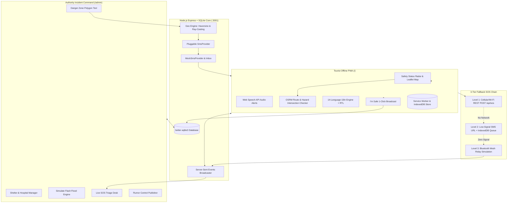

<<<<<<< HEAD
# SafeStay (TravelTech)
### Real-Time Crisis Communication & Evacuation Routing System for Tourists

> **SafeStay** is a life-saving, offline-first emergency coordination platform engineered specifically for foreign and domestic tourists during sudden flash floods, cyclones, and landslides.

---

## 1. Problem Statement

When sudden extreme weather events strike (e.g. cloudburst flash floods in Munnar/Wayanad, landslides in Kodaikanal ghats, or coastal storm surges in Chennai/Rameswaram), tourists face acute vulnerabilities:
1. **Language Barrier & Misinformation**: Emergency sirens and local state bulletins are delivered in vernacular languages without context. Rumors on WhatsApp spark panic.
2. **Hazard Disorientation**: Foreign tourists wander directly into flooded lowlands, raging river bridges, or falling boulder zones.
3. **Overloaded Rescue Hotlines**: Hundreds of non-critical stranded callers overwhelm emergency lines (112, 108), blocking extraction for those suffering critical injuries.
4. **Cellular Blackouts**: In mountainous or flooded valleys, cell towers frequently collapse, leaving tourists with zero connectivity.

**SafeStay** solves this with an end-to-end system:
- **Instant Targeted Alerting**: Identifies tourists inside danger polygons and sends immediate SMS in their preferred native language with the nearest verified shelter and a live link.
- **Offline-First Tourist PWA**: High-contrast safety banner, Web Speech audio readouts, and an intelligent OSRM route checker that detects flood intersections and computes safe detours.
- **3-Tier Escalating SOS Fallback Chain**: Level 1 (Internet REST) &rarr; Level 2 (Low-signal SMS + IndexedDB auto-retry) &rarr; Level 3 (Bluetooth Mesh Relay simulation).
- **"I'm Safe" 1-Click Check-in**: Reduces emergency calls by reassuring authorities and loved ones.

---

## 2. Architecture Diagram



---

## 3. Tech Stack

- **Frontend**: React 18, Vite, TypeScript, Tailwind CSS, Lucide icons. Built as an offline-first installable PWA with Service Worker (`sw.js`) and IndexedDB (`idb`).
- **Mapping & Routing**: Leaflet, OpenStreetMap tiles (cached offline in SW), Public OSRM routing demo engine with resilient straight-line fallback and Turf-style polygon collision detection.
- **Backend**: Node.js, Express, SQLite (`better-sqlite3` in high-throughput WAL mode), Server-Sent Events (`/api/stream`) for real-time live push updates.
- **Multilingual i18n & Speech**: `react-i18next` covering **14 languages**: English, Hindi, Tamil, Malayalam, Telugu, Kannada, Bengali, French, German, Spanish, Arabic (with native RTL support), Chinese, Japanese, Russian. Web Speech API for audible voice readouts.
- **SMS System**: Pluggable `SmsProvider` interface with a live `MockSmsProvider` (visible in the "Simulated Phone Inbox" modal) and optional `TwilioProvider`.

---

## 4. Setup & Running in One Command

### Prerequisites
- Node.js v18+ and npm installed.

### Quick Start

1. **Install Dependencies** (from project root):
   ```bash
   npm install
   ```
   *(Workspaces automatically install root, server, and client packages).*

2. **Seed Realistic Mock Data**:
   ```bash
   npm run seed
   ```
   *Populates realistic danger zones, shelters, multi-national tourists, rumors, and SOS signals for Munnar, Kodaikanal, Chennai Coast, and Rameswaram.*

3. **Start Development Server** (Runs both Server & Client concurrently):
   ```bash
   npm run dev
   ```
   - Tourist PWA: **http://localhost:5173**
   - Authority Admin Console: **http://localhost:5173/admin**
   - QR Tourist Check-in: **http://localhost:5173/register**
   - Backend API & SSE: **http://localhost:3001**

4. **Production Build & Unified Run** (Optional):
   ```bash
   npm run build
   npm start
   ```
   *Serves both API and the full PWA on a single port at `http://localhost:3001`.*

---

## 5. Scripted 3-Minute Demo Walkthrough

### Minute 1: The Crisis Hits & Targeted Alert Dispatched
1. Open **http://localhost:5173/admin** in your browser.
2. Click **"⚡ One-Click Authority Demo Access"** to enter the SDRF Incident Command Portal.
3. Click the bright red button: **"⚡ SIMULATE FLASH FLOOD (DEMO)"**.
4. **Notice what happens instantaneously**:
   - A Red Danger Zone is mapped across the Munnar River basin.
   - 5 international tourists (from France, Germany, Japan, UAE, India) located inside the valley are automatically identified.
   - Nearest shelters are computed using the Haversine geo-engine.
   - Multilingual SMS warnings are dispatched via the `MockSmsProvider`.
5. Click **"SMS Inbox"** in the top navigation. Observe the incoming SMS messages tailored in **French**, **German**, **Arabic**, **Japanese**, and **Hindi**, each containing the exact nearest shelter name, walking distance, and a one-click SafeStay short link.

### Minute 2: The Tourist Experience & Safe Routing
1. In the SMS inbox, click **"Open Link in Tourist App"** on the French SMS for Jean-Luc Moreau (or navigate to `http://localhost:5173/?phone=+33612345678&lang=fr`).
2. The Tourist PWA immediately opens:
   - UI and status banner adapt to French (*"VOUS ÊTES EN ZONE DE DANGER"*).
   - Click **"Écouter l'alerte"** (Read Aloud) to hear the Web Speech API speak the critical evacuation advice aloud.
3. Switch to the **"Safe Route Planner"** tab:
   - Select destination **"KDHP Tea Sanctuary"** or search via Nominatim.
   - Click **"Check Route Safety"**.
   - Notice the verdict banner detects the route crossing the flooded zone (*"Route Crosses Active Hazard Zone!"*).
   - SafeStay automatically computes a safe detour and presents a one-click button: **"Switch Route to Shelter"**.
4. Click **"I'm Safe"** at the top. The green celebration toast confirms the check-in has updated the SDRF dashboard, avoiding unnecessary rescue calls.

### Minute 3: No-Signal Escalation & Bluetooth Mesh Relay
1. Toggle the **"Simulated Offline"** switch in the top navbar (or simulate flight mode). Notice the top bar turns yellow: *"Offline Mode (Using Cached Data)"*.
2. Click the big red **"EMERGENCY SOS"** button.
3. Select Triage Category (**"🚨 Immediate Rescue"**), people count (**"2"**), and click **"BROADCAST EMERGENCY SOS NOW"**.
4. Observe the automated fallback chain:
   - **Level 1 (Internet)** detects cellular blackout.
   - **Level 2 (Low-Signal SMS)** engages, generating a prefilled `sms:` link to the SDRF hotline with exact GPS coordinates and queuing the packet in IndexedDB.
   - Click **"Engage Level 3 BLE Mesh Relay &rarr;"**.
5. The **Interactive Mesh Simulation Mode** pops up on the map:
   - Click **"Start Mesh Hop Simulation"**.
   - Watch the encrypted distress packet hop from **Phone A (Stranded Tourist)** &rarr; **Phone B (Trail Guide)** &rarr; **Jeep C (Ridge Taxi)** &rarr; **Station D** &rarr; **Gateway E (SDRF Incident Command)**.
   - The gateway delivers the packet to the server with 4 hops and RSSI telemetry, moving the live timeline from *Sent* &rarr; *Relayed* &rarr; *Received* &rarr; *Acknowledged*!

---

## 6. Honest Limitations

- **Web Browser Bluetooth Constraints**: Current standard web browsers cannot continuously advertise BLE beacons in the background or maintain ad-hoc ad-hoc mesh topologies when the screen is locked. In production, this requires a native iOS/Android shell utilizing BLE peripheral advertising, Google Nearby Connections, or Apple Multipeer Connectivity.
- **OSRM Public Demo Server**: The public OSRM server (`router.project-osrm.org`) has rate limits and occasionally fluctuates under heavy traffic. SafeStay implements an immediate 4-second timeout that seamlessly falls back to straight-line interpolation and nearest shelter detours.
- **SMS Transmission**: By default, SafeStay uses `MockSmsProvider` so the hackathon reviewer can inspect all sent messages inside the in-app Simulated Phone Inbox without needing paid Twilio credits. A production Twilio provider is included and activates automatically when `TWILIO_ACCOUNT_SID` and `TWILIO_AUTH_TOKEN` environment variables are supplied.

---

## 7. Future Scope & Production Roadmap

1. **Cell Broadcast Integration (NDMA / CAP-CP)**: Integration with the National Disaster Management Authority's Common Alerting Protocol (CAP) and telecom Cell Broadcast Entity (CBE) to push cell-tower level broadcast alerts without requiring phone numbers.
2. **Native iOS & Android Applications**: Native background BLE mesh daemon enabling continuous hopping even when phones are locked or sleeping.
3. **IMD Radar & Flood Sensor Ingestion**: Real-time webhook ingestion from Indian Meteorological Department (IMD) doppler weather radars and Central Water Commission river gauge sensors for automatic polygon generation.
4. **Airline & OTA Booking Integration**: Automatic safety pre-registration when tourists book flights or hotels in disaster-prone regions through MakeMyTrip, Booking.com, or Air India.
5. **Diplomatic Embassy Emergency Portal**: Dedicated access for foreign consulates (US, France, UK, Germany, UAE, Japan) to monitor the safety status of their registered citizens in real time.
=======
# safestay
>>>>>>> 4e44f87fb9650d8169827259e09c61f6350071a3
